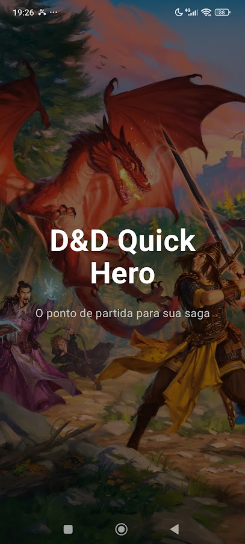
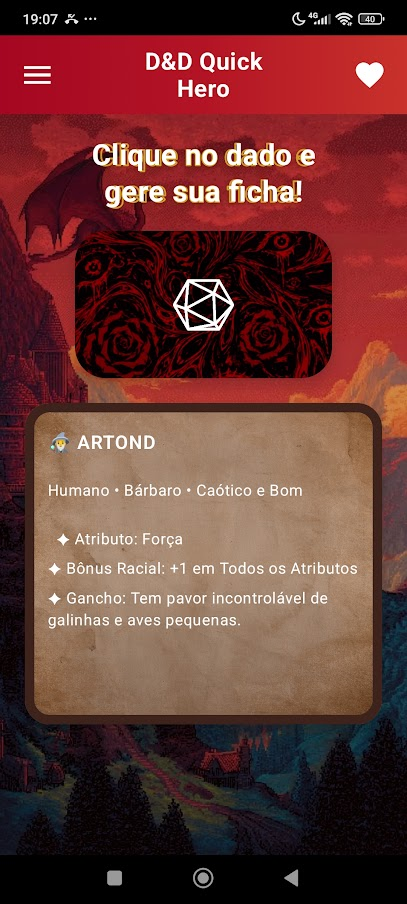
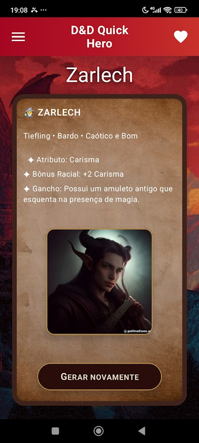

# 🎲 D&D QuickHero

> *"O ponto de partida para sua saga"*

**D&D QuickHero** é um aplicativo Android nativo desenvolvido em **Kotlin** e **Jetpack Compose** criado para ajudar mestres e jogadores de RPG de mesa (Dungeons & Dragons) a superarem bloqueios criativos. Com um toque no dado d20, o aplicativo gera conceitos coerentes de personagens e NPCs, permitindo expandir os detalhes da ficha e invocar retratos exclusivos por meio de Inteligência Artificial.

---

## ✨ Funcionalidades

- **Geração Relacional em Cascata:** Diferente de sorteios puramente aleatórios, o algoritmo garante harmonia narrativa e mecânica:
  - Sorteia a **Classe** e define um **Atributo Destaque** compatível (ex.: *Mago* $\rightarrow$ *Mente Brilhante*).
  - Sorteia a **Raça**, aplica o **Bônus Racial** correspondente e combina prefixos e sufixos específicos daquela cultura para gerar um **Nome** coerente (ex.: *Elfo* $\rightarrow$ *Faerion*).
  - Adiciona **Alinhamento** e um **Gancho de História** (peculiaridade ou motivação) para enriquecer a interpretação.
- **Interface Temática de Fantasia:**
  - **Splash Screen:** Tela de abertura atmosférica com transição automática.
  - **Home Screen:** Botão interativo de d20 com animação de rotação e exibição dinâmica do cartão em textura de pergaminho.
  - **Tela de Detalhes (Ficha Expandida):** Visualização ampliada dos atributos do personagem.
- **Retratos Gerados por IA:** Integração direta na tela de detalhes que traduz os atributos da ficha para um *prompt* artístico e gera uma ilustração única do personagem em tempo real.
- **Fichas Favoritas:** Possibilidade de salvar localmente os melhores conceitos gerados para consulta futura.

---

## 🛠️ Tecnologias e Bibliotecas Utilizadas

- **Linguagem:** [Kotlin](https://kotlinlang.org/)
- **Interface (UI):** [Jetpack Compose](https://developer.android.com/jetpack/compose) & Material Design 3
- **Carregamento de Imagens & IA:** [Coil (`coil-compose`)](https://coil-kt.github.io/coil/) + API [Pollinations.ai](https://pollinations.ai/)
- **Navegação:** Navigation Compose
- **Persistência Local:** SharedPreferences / DataStore com Gson

---

## 📱 Capturas de Tela

| Splash Screen | Tela Principal (Home) | Ficha Expandida + IA |
| :---: | :---: | :---: |
|  |  |  |
